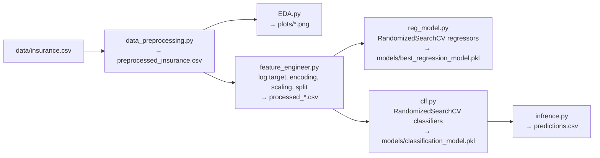

# Insurance ML Pipeline

An end-to-end machine-learning pipeline on the **Medical Cost Personal Dataset** (`insurance.csv`). It covers cleaning, EDA, feature engineering, a **regression** model that predicts (log) medical charges, and a **classification** model that predicts whether a person's charges are above the median. Both models are tuned with `RandomizedSearchCV` over several algorithms. A CLI inference script runs predictions on new data.

## Problem Statement

Insurers need to estimate a customer's expected medical costs from basic attributes (age, sex, BMI, children, smoker status, region). This project tackles the question two ways:

1. **Regression:** predict `log(charges)`.
2. **Classification:** predict a high-cost vs low-cost label, using the median of `log(charges)` on the training set as the threshold.

## Features

- Modular scripts for each stage: preprocessing → EDA → feature engineering → regression / classification → inference.
- Engineered features: BMI category, age category, an `age × BMI` interaction and a `smoker_risk` feature. Multicollinearity is checked with VIF (`statsmodels`).
- Model search across Ridge / Lasso / ElasticNet / Decision Tree / Random Forest / Gradient Boosting / AdaBoost / XGBoost / LightGBM (regression) and Logistic Regression / Decision Tree / Random Forest / Gradient Boosting / AdaBoost / XGBoost / LightGBM (classification).
- Evaluation: R², MAE, MSE, residual and Q-Q plots (regression); accuracy, weighted precision/recall/F1, classification report and confusion matrix (classification).
- CLI inference (`infrence.py`) that accepts CSV or Excel input and can output class probabilities.

## Technologies

Python, pandas, NumPy, scikit-learn, XGBoost, LightGBM, SciPy, statsmodels, joblib, Matplotlib, Seaborn, Jupyter.

## Architecture



## Project Structure

```
.
├── Notebook.ipynb            # full exploratory + modelling workflow (with outputs)
├── data/
│   └── insurance.csv         # 1,338 rows: age, sex, bmi, children, smoker, region, charges
├── Scripts/
│   ├── data_preprocessing.py
│   ├── EDA.py
│   ├── feature_engineer.py
│   ├── reg_model.py
│   ├── clf.py
│   └── infrence.py
├── requirements.txt
└── .gitignore
```

## Installation

```bash
python -m venv venv
venv\Scripts\activate            # Windows  (source venv/bin/activate on Linux/macOS)
pip install -r requirements.txt
```

## Configuration

No environment variables or secrets are required.

## Usage

The scripts read and write their intermediate files in the **current working directory**, and `EDA.py`, `reg_model.py` and `clf.py` write into `plots/` and `models/`, which must exist. Run everything from one folder:

```bash
mkdir plots models
python Scripts/data_preprocessing.py -f data/insurance.csv    # → preprocessed_insurance.csv
python Scripts/EDA.py -f preprocessed_insurance.csv           # → plots/*.png
python Scripts/feature_engineer.py -f preprocessed_insurance.csv   # → processed_X/y_*.csv
python Scripts/reg_model.py                                   # → models/best_regression_model.pkl
python Scripts/clf.py                                         # → models/classification_model.pkl
python Scripts/infrence.py --input new_data.csv --model models/classification_model.pkl \
       --output predictions.csv --include-original
```

`infrence.py` options: `--input/-i` (CSV or Excel, required), `--model/-m` (default `classification_model.pkl`), `--output/-o` (default `predictions.csv`), `--include-original/-inc`. The input must already have the same engineered and encoded columns as the training data.

## Dataset

`data/insurance.csv` is the public *Medical Cost Personal Dataset* (1,338 records, 7 columns). It contains no personal identifiers.

## Results (as recorded in `Notebook.ipynb`)

**Regression (target = log charges)**: best model `GradientBoostingRegressor` (loss = absolute_error, n_estimators = 395, max_depth = 6, learning_rate ≈ 0.226):

| Metric (test set) | Value |
|---|---|
| R² | 0.8412 |
| MAE (log scale) | 0.1876 |
| MSE (log scale) | 0.1465 |

**Classification (above-median charges)**: best model `RandomForestClassifier` (n_estimators = 313, max_depth = 20, bootstrap = False). Best CV score 0.9163.

| Class | Precision | Recall | F1 | Support |
|---|---|---|---|---|
| 0 | 0.90 | 0.95 | 0.93 | 133 |
| 1 | 0.95 | 0.89 | 0.92 | 133 |
| **Accuracy** | | | **0.92** | 266 |

Confusion matrix: `[[127, 6], [14, 119]]`.

These figures come from the notebook run. The standalone scripts re-run the search and may produce slightly different numbers.

## Limitations

- `infrence.py` defaults to `classification_model.pkl` in the working directory, but `clf.py` saves to `models/classification_model.pkl`. Pass `--model` explicitly.
- `plots/` and `models/` are not created automatically.
- Inference expects pre-processed features. Raw `insurance.csv`-style rows are not transformed by `infrence.py`.
- Regression error is reported on the log scale only.
- The `Video/` folder in the original workspace is empty and not part of the repo.

## Future Improvements

- Persist the full preprocessing pipeline with the model so inference accepts raw records.
- Create output folders automatically and unify model paths.
- Report regression error in original currency units and add model explainability (SHAP).

## Author

**Mosap Abdel-Ghany**: [github.com/Mosapmohamd](https://github.com/Mosapmohamd)
